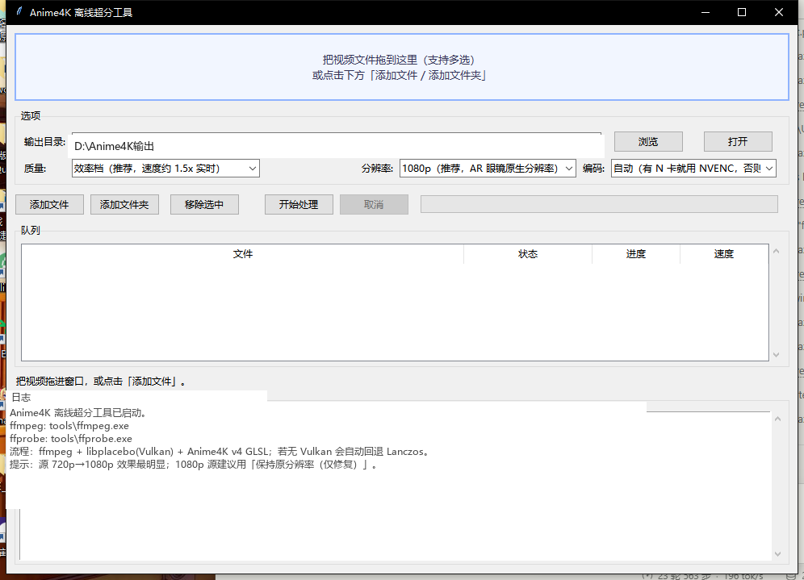

# Anime4K 离线超分工具（Windows）

把视频文件拖进窗口，自动用 **真正的 Anime4K（bloc97/Anime4K v4 GLSL 着色器）** 做超分辨率，导出新的 mp4。
适合把番剧离线视频先「烤」成 1080p 增强版，再放进手机 / AR 眼镜里看——画面上已经带上了 Anime4K 的线条修复和锐化，不依赖播放器或设备是否支持着色器。



## 功能

- **拖拽 / 批量**：拖文件进窗口，或「添加文件 / 添加文件夹」，支持队列批量处理
- **真正的 Anime4K**：ffmpeg + libplacebo(Vulkan) + Anime4K v4 GLSL，官方 Mode A（Fast / HQ）与「仅修复」档
- **可选目标分辨率**：1080p / 1440p / 2160p(4K) / 保持原分辨率（仅修复）
- **硬件编码**：自动检测 NVENC（N 卡）并优先使用，否则 CPU x264；也可手动选 x265
- **进度 / 速度 / 取消**：解析 ffmpeg 进度，可随时取消
- **自动兜底**：Vulkan 不可用时回退「Lanczos 放大 + 锐化」；NVENC 不可用时回退 x264
- **音轨直通**：`-c:a copy` 保留原音轨（复制失败自动转 AAC）
- **中文路径**：带空格/中文的输入输出路径都可以

## 系统要求

- Windows 10 / 11 64 位
- 显卡驱动支持 **Vulkan**（近几年 NVIDIA / AMD / Intel 驱动都可以）
- Python 3.10+（用于运行 `Anime4K_Upscaler.py`；也可用打包版 exe，见 Release）
- 可选：`pip install tkinterdnd2` —— 装上后支持拖拽

## 安装

```powershell
git clone https://github.com/StarrySkyehk/Windows_Anime4K.git
cd Windows_Anime4K

# 下载 ffmpeg / ffprobe 到 tools\（约 150MB 压缩包，脚本只解压两个 exe）
powershell -ExecutionPolicy Bypass -File .\scripts\fetch_tools.ps1

# 可选：拖拽支持
pip install tkinterdnd2
```

> 仓库里不包含 `ffmpeg.exe`（116MB，超过 GitHub 单文件限制）。
> 你也可以自己放一份支持 libplacebo 的 ffmpeg 静态构建到 `tools\ffmpeg.exe`（+ `ffprobe.exe`），
> App 启动时会优先用 `tools\` 里的，找不到再回退 PATH 里的 ffmpeg。
> 验证：`.\tools\ffmpeg.exe -hide_banner -filters | findstr libplacebo` 应该能看到 `libplacebo` 滤镜。

## 使用

1. 双击 `启动.bat`（或 `python Anime4K_Upscaler.py`）
2. 把视频拖进上方区域，或「添加文件 / 添加文件夹」
3. 选择质量档、目标分辨率、编码器
4. 点「开始处理」，完成后输出到指定目录（默认 `桌面\Anime4K输出`）

### 命令行模式（批量 / 排查）

```powershell
python Anime4K_Upscaler.py --cli --input "D:\anime\ep01.mkv" "D:\anime\ep02.mkv" --outdir "D:\out" --preset efficiency --height 1080 --encoder auto
```

参数：

| 参数 | 说明 |
| --- | --- |
| `--preset` | `efficiency`（Mode A Fast）/ `quality`（Mode A HQ） |
| `--height` | `1080` / `1440` / `2160` / `0`（0 = 保持原分辨率，仅修复） |
| `--encoder` | `auto` / `x264` / `x265` / `nvenc` |

输出命名：`<原名>_Anime4K_<高度>p.mp4`（保持原分辨率时为 `_Anime4K_native.mp4`）。

## 质量档说明

| 档位 | Anime4K 着色器链 | 特点 |
| --- | --- | --- |
| 效率档 | Clamp_Highlights → Restore_CNN_M → Upscale_CNN_x2_M → AutoDownscalePre_x2/x4 → Upscale_CNN_x2_S | 官方「低配 Fast」预设，速度和效果平衡 |
| 质量档 | Clamp_Highlights → Restore_CNN_L → Upscale_CNN_x2_L → AutoDownscalePre_x2/x4 → Upscale_CNN_x2_M | 更重的 CNN，线条更强，速度明显慢 |

## 原理

```
ffmpeg（tools/ffmpeg.exe，静态构建）
  └─ libplacebo 滤镜（Vulkan GPU 渲染）
       └─ Anime4K v4 GLSL 链（Clamp_Highlights + Restore_CNN + Upscale_CNN_x2 + AutoDownscalePre …）
            └─ 编码：libx264 / libx265 / NVENC，音频 -c:a copy
```

- 着色器链按 Anime4K 官方预设拼接成一个 `.glsl` 文件（`shaders/chain_*.glsl`），通过 libplacebo 的
  `custom_shader_path` 加载；路径用相对路径（ffmpeg 滤镜参数解析器处理不了 Windows 绝对路径里的盘符冒号）。
- 色彩、时基、音画同步都由 ffmpeg 原生管线处理，不会出现「黑屏 / 闪烁」。
- 如果 Vulkan 初始化失败会自动回退 `scale=lanczos,unsharp`；NVENC 会先做一次真实小测试，不可用就用 x264。

## 性能参考

本机 i5-8265U + MX250（24fps 720p→1080p）：

| 档位 | 10 秒视频耗时 |
| --- | --- |
| 效率档 | 约 8 秒 |
| 质量档 | 约 11~12 秒 |
| 1080p 源「保持原分辨率」 | 约 8 秒 |

实际耗时取决于源分辨率、帧率和显卡；4K 输出会慢很多。

## 常见问题

**Q: 处理完画质真的会变好吗？**
A: Anime4K 擅长修复低分辨率/压缩造成的线条发糊、锯齿和振铃。720p→1080p 提升最明显；1080p 源用「保持原分辨率（仅修复）」主要是线条更干净。

**Q: 支持哪些输入格式？**
A: ffmpeg 能解码的都行：mp4 / mkv / avi / mov / flv / ts / webm / wmv / rmvb …，输出统一 mp4。

**Q: 字幕会保留吗？**
A: 不保留内嵌/外挂字幕（字幕轨会被丢弃）。

**Q: HDR / 10bit 视频？**
A: 统一转 8bit yuv420p（SDR），HDR 内容可能偏灰，建议只对 SDR 番剧使用。

**Q: 提示找不到 ffmpeg / libplacebo 报错？**
A: 先跑 `scripts/fetch_tools.ps1`；仍失败则更新显卡驱动（Vulkan），或改用 Release 里带 ffmpeg 的完整包。

**Q: NVENC 报错？**
A: 远程桌面/旧驱动环境下 NVENC 可能不可用，程序会自动回退 CPU x264。

## 相关项目

- [bloc97/Anime4K](https://github.com/bloc97/Anime4K)：着色器与算法（MIT）
- [BtbN/FFmpeg-Builds](https://github.com/BtbN/FFmpeg-Builds)：Windows ffmpeg 静态构建（含 libplacebo）
- iOS 版（独立 App）：[Kazumi AR 眼镜增强版](https://github.com/StarrySkyehk/kazumi-airplay/releases)

## 第三方组件与许可

- 本项目代码：MIT，见 [LICENSE](LICENSE)
- Anime4K 着色器：MIT，来自 bloc97/Anime4K v4.0.1
- ffmpeg：GPL（本仓库不包含二进制，由脚本或用户自行获取）

详见 [THIRD_PARTY_NOTICES.md](THIRD_PARTY_NOTICES.md)。
